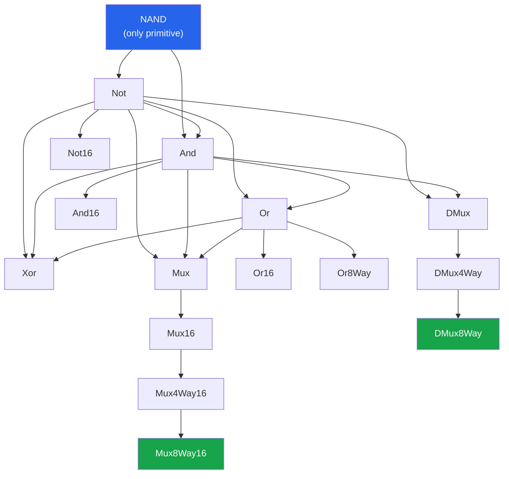

# Project 01 · Boolean Logic

[← Back to Part I overview](../README.md)

> **Nand2Tetris Part I · Project 01** — Build the logic-gate library of the Hack computer from a single primitive: the NAND gate.

## Introduction

Project 01 is the foundation of the whole course. Starting from one NAND gate, you construct every combinational chip that later projects depend on: basic gates, multiplexors, demultiplexors, and their 16-bit and multi-way variants. The ALU, RAM and CPU are all assembled from this folder's chips, so it works as the standard library of the Hack platform.

Every chip in this project is **combinational**: its outputs depend only on the current inputs. There is no clock and no internal state.

## What's in this folder

| File | Chip | What it does |
|---|---|---|
| `Not.hdl` | Not | NOT built from a single NAND (`Nand(a=in, b=in)`). |
| `And.hdl` | And | NAND followed by NOT. |
| `Or.hdl` | Or | De Morgan form: `NOT(NOT a AND NOT b)`. |
| `Xor.hdl` | Xor | `(a AND NOT b) OR (NOT a AND b)`. |
| `Mux.hdl` | Mux | 2:1 selector — `out = a` when `sel = 0`, otherwise `b`. |
| `DMux.hdl` | DMux | Routes `in` to `a` or `b` according to `sel`. |
| `Not16.hdl` | Not16 | Bitwise NOT on a 16-bit bus. |
| `And16.hdl` | And16 | Bitwise AND on two 16-bit buses. |
| `Or16.hdl` | Or16 | Bitwise OR on two 16-bit buses. |
| `Mux16.hdl` | Mux16 | Sixteen parallel `Mux` gates sharing one `sel`. |
| `Or8Way.hdl` | Or8Way | ORs all eight input bits into one output bit. |
| `Mux4Way16.hdl` | Mux4Way16 | 4:1 16-bit mux, built from three `Mux16` chips. |
| `Mux8Way16.hdl` | Mux8Way16 | 8:1 16-bit mux, built from two `Mux4Way16` + one `Mux16`. |
| `DMux4Way.hdl` | DMux4Way | 1:4 selector, built from three `DMux` chips. |
| `DMux8Way.hdl` | DMux8Way | 1:8 selector, built from one `DMux` + two `DMux4Way`. |
| `project1.zip` | — | Coursera submission archive; not needed to build or run. |

## Key concepts

- **NAND is functionally complete.** Any Boolean function can be expressed using NAND alone. This is the course's "from sand to computer" starting point.
- **Truth table → Boolean expression → gate network.** Deriving AND/OR/XOR/Mux from their specifications is the core exercise.
- **De Morgan's laws.** OR is implemented as `NOT(AND(NOT a, NOT b))`; the same idea reappears in the CPU's jump logic.
- **Mux is a hardware `if`, DMux is an address decoder.** RAM uses a DMux tree to route the write signal and a Mux tree to read the selected word.
- **Buses and bit slicing.** A 16-bit chip is usually sixteen 1-bit chips with shared control signals; HDL slices like `in[0..7]` make this explicit.
- **Hierarchical design.** `Mux8Way16` is not built from gates directly — it reuses `Mux4Way16`, which reuses `Mux16`, which reuses `Mux`. Each layer trusts the layer below it.

## Flowchart

Every arrow below means **"is built from"**. NAND is the only root; the selector trees at the bottom are reused by the ALU, RAM and CPU.

The 16-bit bus versions simply replicate a 1-bit gate sixteen times. The multi-way selectors form balanced trees, which is why the depth grows as `log2(n)` rather than `n`.

## Implementation notes

- `Not` is the only chip that touches the primitive directly: `Nand(a=in, b=in)`.
- `And` = NAND + NOT; `Or` = NOT + AND + NOT (De Morgan); `Xor` = two ANDs into an OR.
- `Mux` = `(!sel AND a) OR (sel AND b)`; `DMux` uses the same two AND terms without the final OR.
- `Mux4Way16` uses `sel[0]` for the low pair selection and `sel[1]` for the final Mux16; `Mux8Way16` adds `sel[2]` on top of two `Mux4Way16` chips.
- `DMux8Way` splits on `sel[2]` first, then decodes the low two bits with `DMux4Way` in each half.

## How to verify

The official test scripts (`.tst` / `.cmp`) and the Hardware Simulator are not bundled in this repository. Download the Project 01 test files from [nand2tetris.org](https://www.nand2tetris.org/), open each `.hdl` in the Hardware Simulator, and run the matching test script.

`project1.zip` is the Coursera submission archive and is not required for simulation.
