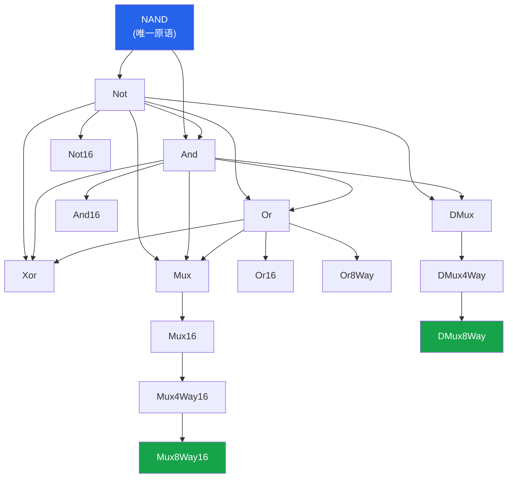

# 项目 01 · 组合逻辑

[← 返回 Part I 总览](../README.md)

> **Nand2Tetris Part I · 项目 01** — 只用一种原语 NAND 门，搭建出 Hack 计算机的整套逻辑门库。

## 项目简介

项目 01 是整个课程的地基。从单个 NAND 门出发，你会构建出后续所有项目都依赖的组合逻辑芯片：基本门、多路选择器、多路分配器，以及它们的 16 位版本和多路版本。ALU、RAM 和 CPU 全部由这个目录里的芯片拼装而成，因此它相当于 Hack 平台的“标准库”。

本项目的所有芯片都是**组合逻辑**：输出只取决于当前输入，没有时钟，也没有内部状态。

## 目录内容

| 文件 | 芯片 | 作用 |
|---|---|---|
| `Not.hdl` | Not | 用单个 NAND 实现非门（`Nand(a=in, b=in)`）。 |
| `And.hdl` | And | NAND 后再接一个 NOT。 |
| `Or.hdl` | Or | 德摩根形式：`NOT(NOT a AND NOT b)`。 |
| `Xor.hdl` | Xor | `(a AND NOT b) OR (NOT a AND b)`。 |
| `Mux.hdl` | Mux | 2 选 1：`sel = 0` 时输出 `a`，否则输出 `b`。 |
| `DMux.hdl` | DMux | 根据 `sel` 把 `in` 送到 `a` 或 `b`。 |
| `Not16.hdl` | Not16 | 对 16 位总线逐位取反。 |
| `And16.hdl` | And16 | 对两条 16 位总线逐位相与。 |
| `Or16.hdl` | Or16 | 对两条 16 位总线逐位相或。 |
| `Mux16.hdl` | Mux16 | 16 个 `Mux` 并联，共用一个 `sel`。 |
| `Or8Way.hdl` | Or8Way | 把 8 个输入位全部 OR 成一个输出位。 |
| `Mux4Way16.hdl` | Mux4Way16 | 4 选 1 的 16 位选择器，由 3 个 `Mux16` 组成。 |
| `Mux8Way16.hdl` | Mux8Way16 | 8 选 1 的 16 位选择器，由 2 个 `Mux4Way16` + 1 个 `Mux16` 组成。 |
| `DMux4Way.hdl` | DMux4Way | 1 分 4，由 3 个 `DMux` 组成。 |
| `DMux8Way.hdl` | DMux8Way | 1 分 8，由 1 个 `DMux` + 2 个 `DMux4Way` 组成。 |
| `project1.zip` | — | Coursera 提交存档，运行和验证时不需要。 |

## 知识点

- **NAND 的函数完备性**：任何布尔函数都可以只用 NAND 表达。这是整门课“从沙子造计算机”的起点。
- **真值表 → 布尔表达式 → 门级电路**：从规格推导出 AND/OR/XOR/Mux 是本章的核心练习。
- **德摩根定律**：OR 被实现为 `NOT(AND(NOT a, NOT b))`；同样的思路后面还会出现在 CPU 的跳转逻辑里。
- **Mux 是硬件版的 `if`，DMux 是地址译码器**：RAM 用 DMux 树把写信号送到选中的寄存器，再用 Mux 树把选中寄存器的值读出来。
- **总线与位切片**：16 位芯片通常就是 16 个 1 位芯片加一组共享控制信号；HDL 的 `in[0..7]` 这类写法让这一点很直观。
- **层次化设计**：`Mux8Way16` 并没有直接堆到门级，而是复用 `Mux4Way16`，后者复用 `Mux16`，后者复用 `Mux`。每一层都信任下一层。

## 流程图

下图中的每条箭头都表示 **“由……构成”**。NAND 是唯一的根；最下面的多路选择器树会被 ALU、RAM 和 CPU 复用。

16 位总线版本只是把 1 位门复制 16 份；多路选择器则组成平衡树，因此深度是 `log2(n)` 级，而不是 `n` 级。

## 实现要点

- `Not` 是唯一直接使用原语的芯片：`Nand(a=in, b=in)`。
- `And` = NAND + NOT；`Or` = NOT + AND + NOT（德摩根）；`Xor` = 两个 AND 再 OR。
- `Mux` = `(!sel AND a) OR (sel AND b)`；`DMux` 使用同样的两个 AND 项，只是不再 OR 回去。
- `Mux4Way16` 用 `sel[0]` 选择低位的那一对，用 `sel[1]` 做最后的 Mux16；`Mux8Way16` 在此基础上再用 `sel[2]` 选择两个 `Mux4Way16` 的结果。
- `DMux8Way` 先用 `sel[2]` 分成两半，再在每一半里用 `DMux4Way` 译码低两位。

## 验证方式

官方的测试脚本（`.tst` / `.cmp`）和 Hardware Simulator 不在本仓库中。请从 [nand2tetris.org](https://www.nand2tetris.org/) 下载 Project 01 的测试文件，在 Hardware Simulator 中打开对应的 `.hdl`，再运行匹配的测试脚本。

`project1.zip` 是 Coursera 的提交存档，仿真时不需要。
