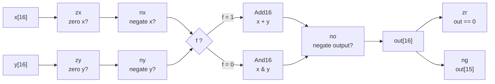
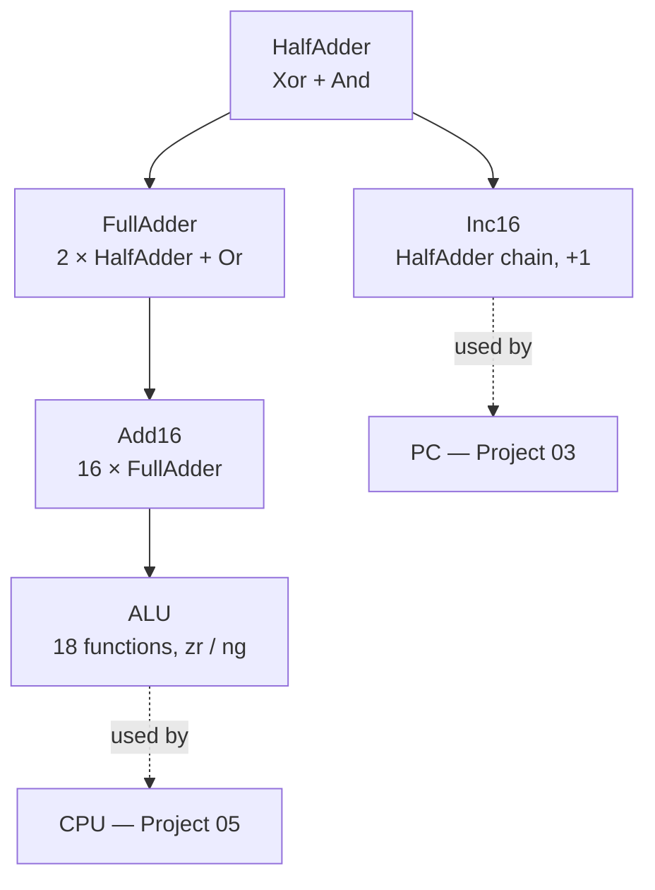

# Project 02 · Boolean Arithmetic

[← Back to Part I overview](../README.md)

> **Nand2Tetris Part I · Project 02** — Turn the Project 01 gates into adders, an incrementer, and the 16-bit ALU.

## Introduction

Project 02 is where logic becomes arithmetic. Using only the gates from Project 01, you build a half adder, a full adder, a 16-bit ripple-carry adder, a 16-bit incrementer, and finally the **ALU** — the component that executes every arithmetic and logical operation in the Hack CPU.

Everything here is still combinational. The ALU does not remember anything; it simply applies a fixed transformation selected by six control bits to its two 16-bit inputs.

## What's in this folder

| File | Chip | What it does |
|---|---|---|
| `HalfAdder.hdl` | HalfAdder | Adds two bits: `sum = a XOR b`, `carry = a AND b`. |
| `FullAdder.hdl` | FullAdder | Adds three bits (`a + b + c`); two HalfAdders plus an OR for the carry. |
| `Add16.hdl` | Add16 | 16-bit ripple-carry adder: sixteen FullAdders chained by carry. |
| `Inc16.hdl` | Inc16 | 16-bit incrementer: `out = in + 1`, built from a HalfAdder chain. |
| `ALU.hdl` | ALU | 18 functions selected by `zx, nx, zy, ny, f, no`; also produces `zr` and `ng`. |
| `project2.zip` | — | Coursera submission archive; not needed to build or run. |

## Key concepts

- **Binary addition and the carry chain.** A full adder produces one sum bit and one carry bit; `Add16` threads the carry from bit 0 to bit 15.
- **Two's complement.** Subtraction is addition of the negated operand (`-y = !y + 1`); the ALU reuses the same adder for `x + y`, `x - y` and `y - x`.
- **Ripple carry.** `Add16` is simple but the carry must settle through all 16 stages; the final carry out of bit 15 is discarded, which is exactly 16-bit wraparound.
- **The ALU control pipeline.** The six control bits are applied in order: `zx → nx → zy → ny → f → no`. Each step transforms the operands or the result, and the order matters.
- **Status flags.** `zr = 1` when the output is zero (computed with two `Or8Way` chips and a final OR/NOT); `ng` is simply `out[15]`, the sign bit.
- **Control bits are instruction fields.** In Project 05 the CPU feeds six instruction bits straight into the ALU — this is the bridge between machine code and hardware.

## Flowchart

### ALU data flow

By choosing different control bits, the same datapath computes `0, 1, -1, x, y, !x, !y, -x, -y, x+1, y+1, x-1, y-1, x+y, x-y, y-x, x&y, x|y` — 18 functions in total.

### Build order

The dashed arrows point forward: `Inc16` becomes part of the program counter, and the ALU becomes the execution core of the CPU.

## Implementation notes

- **HalfAdder:** `Xor(a, b) = sum`, `And(a, b) = carry`.
- **FullAdder:** first HalfAdder on `a, b` gives `s, c1`; second on `s, c` gives `sum, c2`; `carry = c1 OR c2`.
- **Add16:** bit 0 uses `c = false`; bits 1–15 use the previous carry; bit 15's carry out is ignored.
- **Inc16:** bit 0 uses a HalfAdder with `b = true` (carry-in 1); the remaining bits use HalfAdders with the previous carry.
- **ALU:** two `Mux16` stages per input implement `zx/nx` and `zy/ny`; `And16` and `Add16` run in parallel and `f` selects between them; `no` selects between the result and its bitwise NOT. The result is split into `out[0..7]` and `out[8..15]` for the zero test, and `out[15]` drives `ng`.

## How to verify

The official test scripts (`.tst` / `.cmp`) and the Hardware Simulator are not bundled in this repository. Download the Project 02 test files from [nand2tetris.org](https://www.nand2tetris.org/), open each `.hdl` in the Hardware Simulator, and run the matching script.

`project2.zip` is the Coursera submission archive and is not required for simulation.
