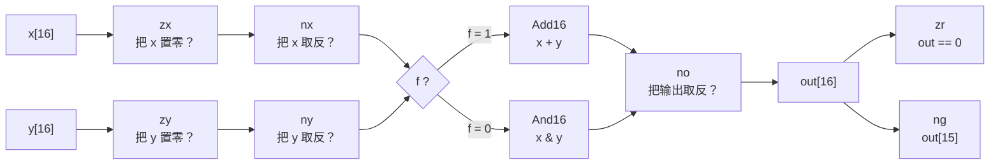
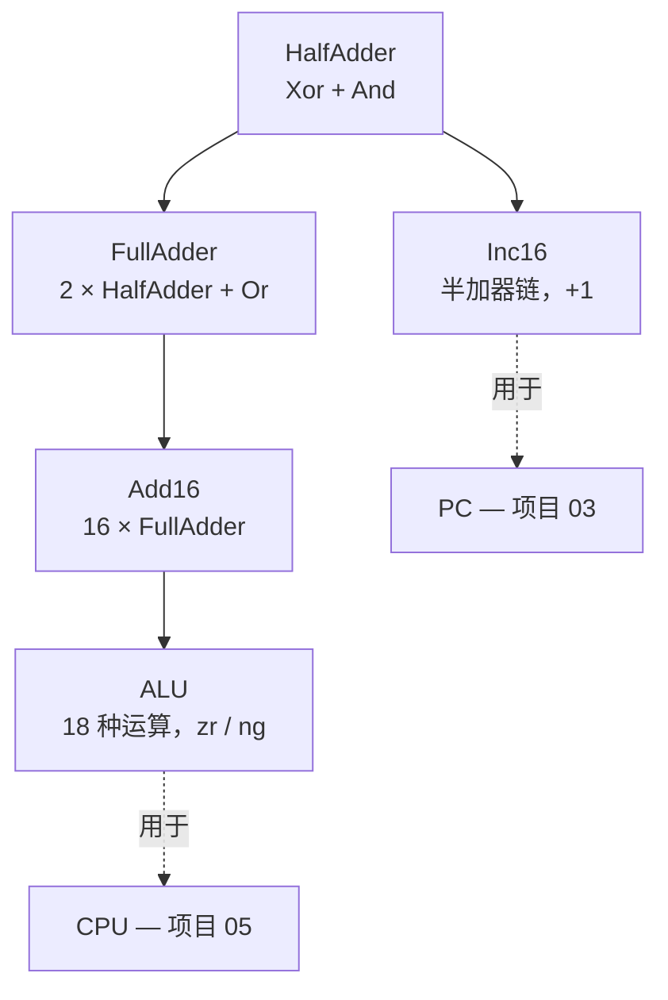

# 项目 02 · 布尔算术

[← 返回 Part I 总览](../README.md)

> **Nand2Tetris Part I · 项目 02** — 把项目 01 的逻辑门变成加法器、增量器和 16 位 ALU。

## 项目简介

项目 02 是“逻辑变算术”的一章。只用项目 01 的门电路，你会依次做出半加器、全加器、16 位行波进位加法器、16 位增量器，最后是 **ALU** —— Hack CPU 中执行所有算术与逻辑运算的部件。

本项目仍然全部是组合逻辑。ALU 不保存任何状态，它只是按照 6 个控制位，对两个 16 位输入做一次固定的变换。

## 目录内容

| 文件 | 芯片 | 作用 |
|---|---|---|
| `HalfAdder.hdl` | HalfAdder | 两个 1 位相加：`sum = a XOR b`，`carry = a AND b`。 |
| `FullAdder.hdl` | FullAdder | 三个 1 位相加（`a + b + c`）：两个半加器加一个 OR 产生进位。 |
| `Add16.hdl` | Add16 | 16 位行波进位加法器：16 个全加器由进位串联。 |
| `Inc16.hdl` | Inc16 | 16 位增量器：`out = in + 1`，由半加器链构成。 |
| `ALU.hdl` | ALU | 由 `zx, nx, zy, ny, f, no` 选择 18 种运算，并输出 `zr`、`ng` 标志。 |
| `project2.zip` | — | Coursera 提交存档，运行和验证时不需要。 |

## 知识点

- **二进制加法与进位链**：全加器产生 1 位和与 1 位进位；`Add16` 把进位从第 0 位一路传到第 15 位。
- **补码**：减法就是加上取负后的操作数（`-y = !y + 1`）；ALU 用同一个加法器同时实现 `x + y`、`x - y` 和 `y - x`。
- **行波进位**：`Add16` 结构简单，但进位要依次穿过 16 级；第 15 位向外的进位被丢弃，这正好就是 16 位回绕。
- **ALU 的控制流水线**：6 个控制位按 `zx → nx → zy → ny → f → no` 的顺序生效，每一步都在变换操作数或结果，顺序不能乱。
- **状态标志**：输出为 0 时 `zr = 1`（用两个 `Or8Way` 加最后的 OR/NOT 得到）；`ng` 直接取 `out[15]`，也就是符号位。
- **控制位就是指令字段**：到了项目 05，CPU 会把指令中的 6 个位直接接到 ALU —— 这就是机器码与硬件之间的桥梁。

## 流程图

### ALU 数据流

选择不同的控制位，同一条数据通路就能算出 `0, 1, -1, x, y, !x, !y, -x, -y, x+1, y+1, x-1, y-1, x+y, x-y, y-x, x&y, x|y` —— 共 18 种运算。

### 构建顺序

虚线箭头指向后续项目：`Inc16` 会成为程序计数器的一部分，ALU 则成为 CPU 的执行核心。

## 实现要点

- **HalfAdder**：`Xor(a, b) = sum`，`And(a, b) = carry`。
- **FullAdder**：第一个半加器处理 `a, b` 得到 `s, c1`；第二个处理 `s, c` 得到 `sum, c2`；`carry = c1 OR c2`。
- **Add16**：第 0 位使用 `c = false`；第 1–15 位使用前一位的进位；第 15 位的进位输出丢弃。
- **Inc16**：第 0 位使用 `b = true` 的半加器（进位输入为 1）；其余位用前一位的进位作为半加器的 `b`。
- **ALU**：每个输入经过两级 `Mux16` 实现 `zx/nx` 与 `zy/ny`；`And16` 和 `Add16` 并行计算，由 `f` 选择；`no` 在结果与按位取反之间选择。输出拆成 `out[0..7]` 和 `out[8..15]` 做零检测，`out[15]` 驱动 `ng`。

## 验证方式

官方的测试脚本（`.tst` / `.cmp`）和 Hardware Simulator 不在本仓库中。请从 [nand2tetris.org](https://www.nand2tetris.org/) 下载 Project 02 的测试文件，在 Hardware Simulator 中打开对应的 `.hdl`，再运行匹配的脚本。

`project2.zip` 是 Coursera 的提交存档，仿真时不需要。
