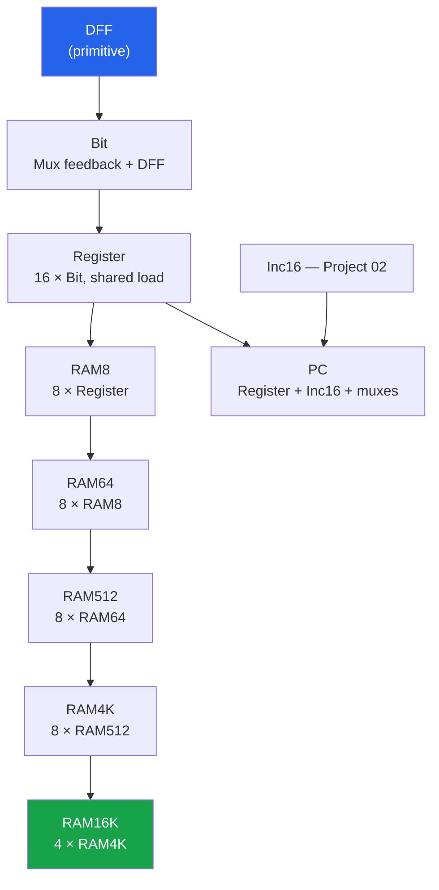
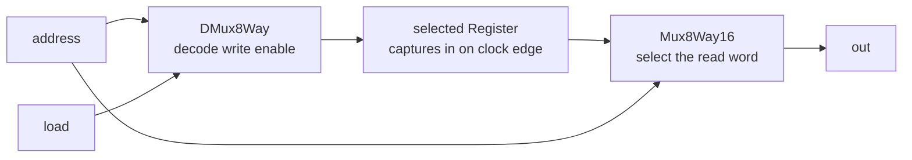

# Project 03 · Sequential Logic & Memory

[← Back to Part I overview](../README.md)

> **Nand2Tetris Part I · Project 03** — Introduce time and state: flip-flops, registers, the RAM hierarchy, and the program counter.

## Introduction

Project 03 is the first project with **memory**. A new primitive is introduced — the data flip-flop (DFF) — and from it you build a 1-bit register, a 16-bit register, the complete RAM hierarchy (`RAM8` → `RAM16K`), and the PC (program counter).

The key new idea is **time**. In a sequential chip, the output at time `t+1` depends on the inputs at time `t`. The simulator drives a clock, and the chips remember values between cycles. This is what makes a computer more than a calculator.

## What's in this folder

| File | Chip | Capacity / behavior |
|---|---|---|
| `Bit.hdl` | Bit | 1-bit register; `out(t+1) = in(t)` when `load = 1`, otherwise holds its value. |
| `Register.hdl` | Register | 16-bit register made of 16 `Bit` chips sharing one `load`. |
| `RAM8.hdl` | RAM8 | 8 × 16-bit words; DMux8Way routes the write, Mux8Way16 selects the read. |
| `RAM64.hdl` | RAM64 | 64 words, built from eight RAM8 chips. |
| `RAM512.hdl` | RAM512 | 512 words, built from eight RAM64 chips. |
| `RAM4K.hdl` | RAM4K | 4096 words, built from eight RAM512 chips. |
| `RAM16K.hdl` | RAM16K | 16384 words, built from four RAM4K chips. |
| `PC.hdl` | PC | 16-bit program counter with `reset`, `load`, `inc`; priority: reset > load > inc. |
| `project3.zip` | — | Coursera submission archive; not needed to build or run. |

## Key concepts

- **Combinational vs sequential logic.** Combinational chips answer instantly from their inputs; sequential chips also depend on their previous state.
- **The clock and the `t` / `t-1` convention.** The HDL specification writes behavior as `out(t+1) = f(in(t))`; the simulator advances one clock cycle at a time.
- **Memory from a Mux and a DFF.** `Bit` feeds the DFF output back into a Mux. When `load = 0` the Mux recirculates the old value; when `load = 1` it captures the new input. The feedback loop is what stores the bit.
- **Read is combinational, write is clocked.** RAM always outputs the selected word; a write only changes the selected word on the clock edge.
- **Hierarchical address decoding.** Each RAM level splits the address: the low bits select a word inside a bank, the high bits select a bank. This is why a big RAM is just a tree of smaller RAMs.
- **The PC's three operations and their priority.** `reset` wins over `load`, and `load` wins over `inc`. The CPU uses `load` for jumps and `inc` for normal execution.

## Flowchart

### Construction hierarchy

Every arrow means "built from". The RAM sizes grow by factors of 8 until the final 16K memory, which uses four 4K banks.

### Read / write path inside one RAM level

The address reaches both trees. The DMux tree ensures that only the selected register's `load` is asserted; the Mux tree makes the selected register's value visible at `out`.

## Implementation notes

- **Bit:** `Mux(a=w, b=in, sel=load)` feeds the DFF; the DFF output `w` loops back to the Mux. `out` is taken from the DFF.
- **Register:** sixteen `Bit` chips, each connected to `in[i]` and the common `load`, producing `out[i]`.
- **RAM8:** `DMux8Way(in=load, sel=address)` creates eight per-register load signals; eight `Register` chips store the words; `Mux8Way16(sel=address)` selects the output.
- **RAM64 / RAM512 / RAM4K:** the same pattern with the low bits addressing inside a bank and the high bits selecting the bank: `RAM64` uses `address[0..2]` / `address[3..5]`, `RAM512` uses `[0..5]` / `[6..8]`, `RAM4K` uses `[0..8]` / `[9..11]`.
- **RAM16K:** four `RAM4K` banks selected by `address[12..13]`, with `address[0..11]` passed down. This level uses `DMux4Way` / `Mux4Way16` because there are four banks, not eight.
- **PC:** `Inc16` computes `previous + 1`; a Mux selects between the increment and `in` using `load`; a second Mux forces `0` using `reset`; the register's `load` is asserted when any of `load`, `reset` or `inc` is true. This gives `reset > load > inc` priority.

## How to verify

The official test scripts (`.tst` / `.cmp`) and the Hardware Simulator are not bundled in this repository. Download the Project 03 test files from [nand2tetris.org](https://www.nand2tetris.org/). Sequential chips must be tested with the simulator's clock: step the clock and observe that values persist between cycles.

`project3.zip` is the Coursera submission archive and is not required for simulation.
