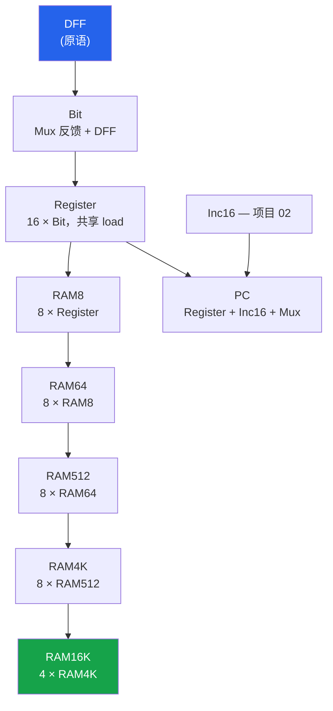
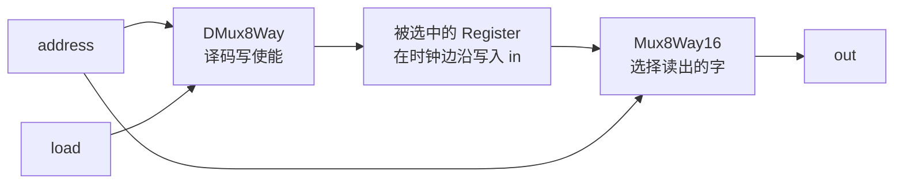

# 项目 03 · 时序逻辑与存储

[← 返回 Part I 总览](../README.md)

> **Nand2Tetris Part I · 项目 03** — 引入时间与状态：触发器、寄存器、RAM 层次结构和程序计数器。

## 项目简介

项目 03 是第一个带**记忆**的项目。课程在这里引入新原语 —— D 触发器（DFF），并用它构建 1 位寄存器、16 位寄存器、完整的 RAM 层次（`RAM8` → `RAM16K`）以及 PC（程序计数器）。

核心的新概念是**时间**。在时序芯片中，`t+1` 时刻的输出取决于 `t` 时刻的输入。模拟器会驱动时钟，芯片在周期之间保存状态。正是这一点让计算机不再只是一台计算器。

## 目录内容

| 文件 | 芯片 | 容量 / 行为 |
|---|---|---|
| `Bit.hdl` | Bit | 1 位寄存器；`load = 1` 时 `out(t+1) = in(t)`，否则保持原值。 |
| `Register.hdl` | Register | 16 位寄存器，由 16 个共享 `load` 的 `Bit` 组成。 |
| `RAM8.hdl` | RAM8 | 8 个 16 位字；DMux8Way 分发写信号，Mux8Way16 选择读出。 |
| `RAM64.hdl` | RAM64 | 64 个字，由 8 个 RAM8 组成。 |
| `RAM512.hdl` | RAM512 | 512 个字，由 8 个 RAM64 组成。 |
| `RAM4K.hdl` | RAM4K | 4096 个字，由 8 个 RAM512 组成。 |
| `RAM16K.hdl` | RAM16K | 16384 个字，由 4 个 RAM4K 组成。 |
| `PC.hdl` | PC | 16 位程序计数器，支持 `reset`、`load`、`inc`；优先级：reset > load > inc。 |
| `project3.zip` | — | Coursera 提交存档，运行和验证时不需要。 |

## 知识点

- **组合逻辑 vs 时序逻辑**：组合芯片立刻根据输入给出结果；时序芯片还会依赖上一时刻的状态。
- **时钟与 `t` / `t-1` 约定**：HDL 规格把行为写成 `out(t+1) = f(in(t))`；模拟器一次推进一个时钟周期。
- **用 Mux + DFF 造记忆**：`Bit` 把 DFF 的输出反馈回 Mux。`load = 0` 时 Mux 把旧值送回 DFF；`load = 1` 时捕获新输入。这个反馈回路就是“记住”一位的原因。
- **读是组合的，写是时钟驱动的**：RAM 始终输出被选中的字；写操作只在时钟边沿修改被选中的字。
- **层次化地址译码**：每一级 RAM 都把地址拆成两部分：低位在 bank 内选字，高位选 bank。大容量 RAM 因此只是小 RAM 组成的树。
- **PC 的三种操作及优先级**：`reset` 优先于 `load`，`load` 优先于 `inc`。CPU 用 `load` 实现跳转，用 `inc` 实现顺序执行。

## 流程图

### 构建层次

每条箭头都表示“由……构成”。RAM 容量按 8 倍逐级增长，最后的 16K 内存由 4 个 4K bank 组成。

### 单级 RAM 的读写路径

地址同时送到两棵树：DMux 树保证只有被选中寄存器的 `load` 有效；Mux 树则把被选中寄存器的值送到 `out`。

## 实现要点

- **Bit**：`Mux(a=w, b=in, sel=load)` 的输出接 DFF；DFF 的输出 `w` 反馈回 Mux；`out` 取自 DFF。
- **Register**：16 个 `Bit`，第 `i` 个连接 `in[i]` 和公共的 `load`，输出 `out[i]`。
- **RAM8**：`DMux8Way(in=load, sel=address)` 产生 8 个寄存器各自的 load；8 个 `Register` 保存数据；`Mux8Way16(sel=address)` 选出输出。
- **RAM64 / RAM512 / RAM4K**：同一模式，低位在 bank 内寻址，高位选 bank：`RAM64` 用 `address[0..2]` / `address[3..5]`，`RAM512` 用 `[0..5]` / `[6..8]`，`RAM4K` 用 `[0..8]` / `[9..11]`。
- **RAM16K**：4 个 `RAM4K` bank 由 `address[12..13]` 选择，`address[0..11]` 继续向下传。因为只有 4 个 bank，这一层使用 `DMux4Way` / `Mux4Way16`。
- **PC**：`Inc16` 计算 `previous + 1`；第一个 Mux 用 `load` 在增量和 `in` 之间选择；第二个 Mux 用 `reset` 强制输出 0；只要 `load`、`reset`、`inc` 任一为真，寄存器就使能。由此得到 `reset > load > inc` 的优先级。

## 验证方式

官方的测试脚本（`.tst` / `.cmp`）和 Hardware Simulator 不在本仓库中。请从 [nand2tetris.org](https://www.nand2tetris.org/) 下载 Project 03 的测试文件。时序芯片必须在模拟器中配合时钟测试：单步推进时钟，观察数值能否跨周期保持。

`project3.zip` 是 Coursera 的提交存档，仿真时不需要。
