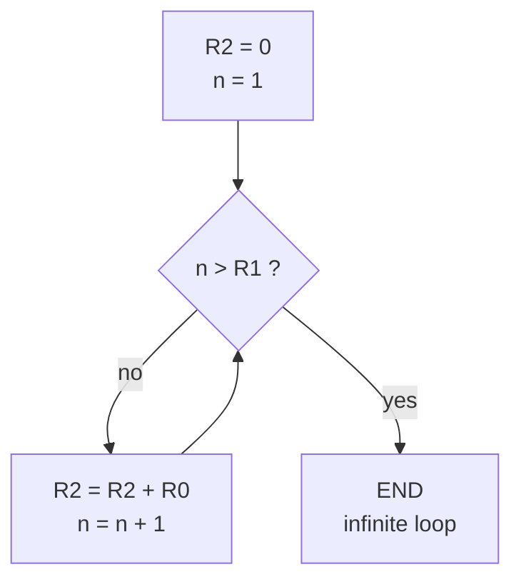
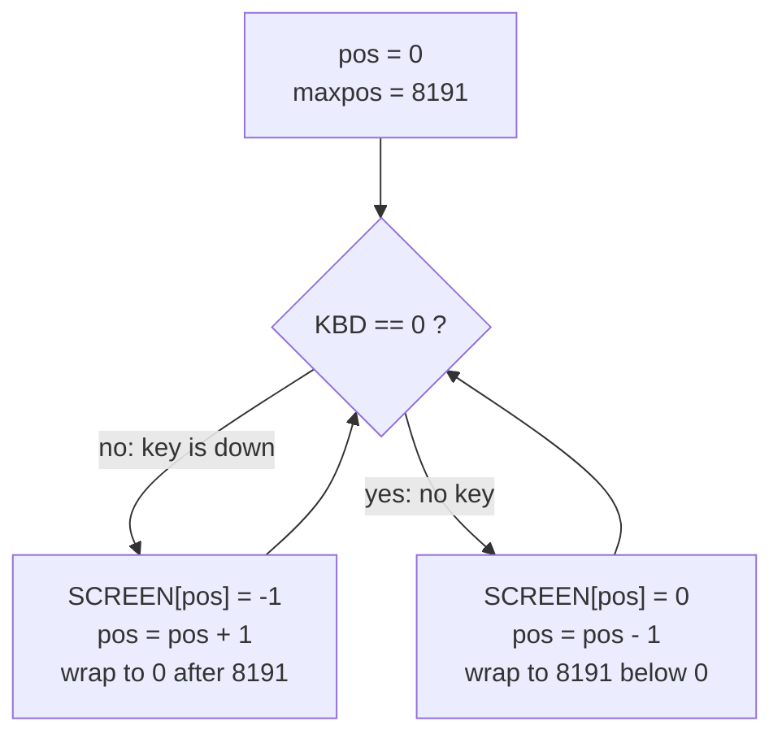

# Project 04 · Machine Language

[← Back to Part I overview](../README.md)

> **Nand2Tetris Part I · Project 04** — Write two programs directly in Hack assembly: multiplication by repeated addition and a keyboard-driven screen filler.

## Introduction

Project 04 crosses from hardware into software. There is no compiler and no high-level language yet: you write Hack machine instructions by hand, managing registers, variables, labels and jumps yourself.

The two programs are deliberately primitive. `Mult.asm` computes `R2 = R0 * R1` even though the CPU has no multiply instruction — it adds `R0` exactly `R1` times. `Fill.asm` polls the keyboard forever and paints the screen black while a key is down and white when it is released.

## What's in this folder

| File | Program | Description |
|---|---|---|
| `Mult.asm` | Multiplication | `R2 = R0 * R1` by repeated addition; uses a loop counter in RAM[16]. |
| `Fill.asm` | Screen fill | Infinite loop: if any key is pressed, write `-1` (black) to the screen; otherwise write `0` (white). |
| `project4.zip` | — | Coursera submission archive; not needed to run. |

## Key concepts

- **The Hack instruction set.** Every instruction is 16 bits. An **A-instruction** (`@value`) loads a 15-bit constant or address into the A register. A **C-instruction** (`dest=comp;jump`) computes a value, stores it, and optionally jumps.
- **Three operands: A, D, M.** `A` and `D` are CPU registers; `M` means `RAM[A]`. Loading an address into `A` and then using `M` is the Hack way to dereference a pointer.
- **Labels and variables.** `(LOOP)` defines a label; `@LOOP` jumps to it. Variables such as `n`, `pos` and `maxpos` are automatically allocated from `RAM[16]` upward by the assembler.
- **Control flow without high-level constructs.** There is no `for`, `while`, `if` or `*`. Loops are labels plus conditional jumps (`JGT`, `JEQ`, `JLT`, …); multiplication is a loop of additions.
- **Memory-mapped I/O.** `SCREEN = 16384` and `KBD = 24576`. Reading `RAM[KBD]` returns the current key code (`0` when no key is pressed); writing to screen memory changes pixels. The screen is 512 pixels wide × 256 pixels high, stored as 256 rows × 32 words = 8192 words, each word holding 16 pixels.
- **Signed comparison.** `D;JGT` jumps when `D > 0`, which is how the multiplication loop decides when `n` has passed `R1`.
- **Halt by infinite loop.** `(END) @END 0;JMP` is the Hack idiom for "stop here".

### Instruction formats

| Type | 16-bit format | Example |
|---|---|---|
| A-instruction | `0` + 15-bit value | `@SCREEN` |
| C-instruction | `111` + `a` + `comp[6]` + `dest[3]` + `jump[3]` | `D=M+1;JGT` |

## Flowchart

### `Mult.asm` — R2 = R0 × R1

The loop runs `R1` times and adds `R0` on each pass. The program assumes `R1 >= 0`; if `R1` is zero or negative, the loop is skipped and the result is `0`.

### `Fill.asm` — keyboard-driven screen

Each iteration paints **one 16-pixel word**, then moves the position. The loop runs continuously, so the whole screen finishes turning black (or white) after 8192 iterations. The wrap-around makes the fill repeat forever while the key state is held or released.

## Implementation notes

- **Mult:** `R0`, `R1`, `R2` are the predefined symbols for `RAM[0..2]`. The counter `n` is a new variable starting at `RAM[16]`. The test `n > R1` is computed as `D = n - R1` followed by `D;JGT`.
- **Fill:** `pos` and `maxpos` are variables. The screen address is computed at run time with `@SCREEN`, `D=A`, `A=D+M`. Writing `-1` sets all 16 bits of the word, which draws 16 black pixels; writing `0` clears them.
- **Keyboard check:** `@KBD; D=M` returns `0` when nothing is pressed and a nonzero key code otherwise. The branch `D;JNE` selects the blacken path; `D;JEQ` selects the clear path.
- **Why one word per iteration?** It keeps the loop body small and gives a visible animated fill. It also means a very fast key tap may be missed between polls — a normal trade-off in polling loops.

## How to run

Load either `.asm` file directly into the official **CPU Emulator**, or assemble it first with the Project 06 assembler.

- **Mult:** set `RAM[0]` and `RAM[1]`, run the program, then inspect `RAM[2]`.
- **Fill:** run the program, click the screen and press a key; the display should turn black while a key is held and white when released. Use the emulator's speed control if the fill animation is too fast.

The official `.tst` / `.cmp` scripts are not bundled in this repository; download them from [nand2tetris.org](https://www.nand2tetris.org/) if needed.
