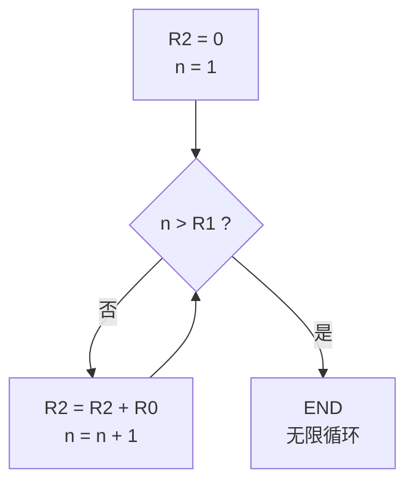
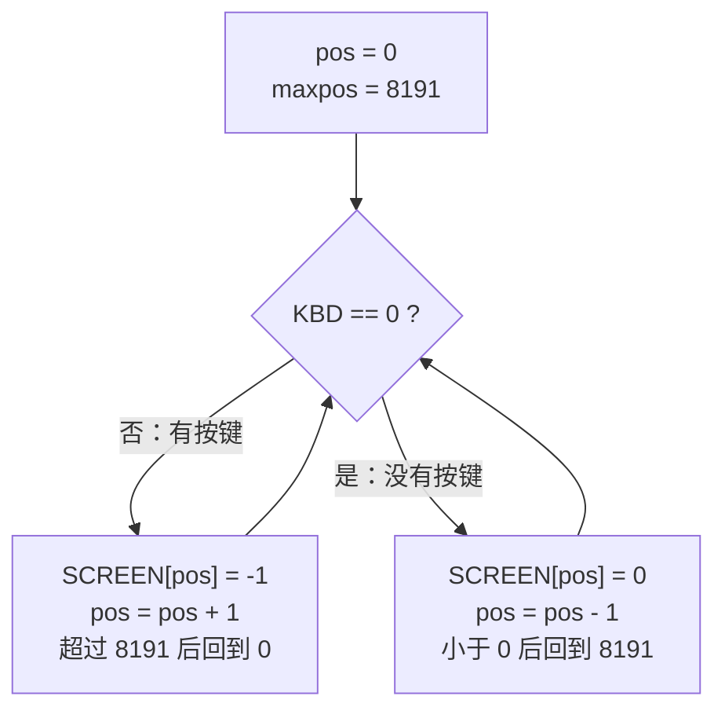

# 项目 04 · 机器语言

[← 返回 Part I 总览](../README.md)

> **Nand2Tetris Part I · 项目 04** — 直接用 Hack 汇编写两个程序：用重复加法实现乘法，以及由键盘控制的屏幕填充。

## 项目简介

项目 04 从硬件跨入软件。这里还没有编译器和高级语言：你需要手写 Hack 机器指令，自己管理寄存器、变量、标签和跳转。

两个程序刻意保持原始。`Mult.asm` 计算 `R2 = R0 * R1`，而 CPU 根本没有乘法指令 —— 它把 `R0` 连续加 `R1` 次。`Fill.asm` 永远轮询键盘：按键时把屏幕涂黑，松开时清屏。

## 目录内容

| 文件 | 程序 | 说明 |
|---|---|---|
| `Mult.asm` | 乘法 | 用重复加法计算 `R2 = R0 * R1`；循环计数器存放在 RAM[16]。 |
| `Fill.asm` | 屏幕填充 | 无限循环：按键时向屏幕写 `-1`（黑），否则写 `0`（白）。 |
| `project4.zip` | — | Coursera 提交存档，运行程序时不需要。 |

## 知识点

- **Hack 指令集**：每条指令 16 位。**A 指令**（`@value`）把 15 位常数或地址装入 A 寄存器；**C 指令**（`dest=comp;jump`）计算一个值、写入目标，并可选地跳转。
- **三个可操作对象 A、D、M**：`A` 和 `D` 是 CPU 寄存器；`M` 表示 `RAM[A]`。先把地址装入 `A`，再使用 `M`，就是 Hack 的解引用方式。
- **标签与变量**：`(LOOP)` 定义标签，`@LOOP` 跳转到它。`n`、`pos`、`maxpos` 这类变量由汇编器自动从 `RAM[16]` 开始分配。
- **没有高级结构的控制流**：没有 `for`、`while`、`if`，也没有 `*`。循环就是标签加条件跳转（`JGT`、`JEQ`、`JLT` 等）；乘法就是一个不断做加法的循环。
- **内存映射 I/O**：`SCREEN = 16384`，`KBD = 24576`。读 `RAM[KBD]` 得到当前按键码（没按键时为 `0`）；写屏幕内存就会改变像素。屏幕为 512 像素宽 × 256 像素高，按 256 行 × 32 字存储，共 8192 个字，每个字包含 16 个像素。
- **有符号比较**：`D;JGT` 在 `D > 0` 时跳转，乘法循环正是用它判断 `n` 是否已经超过 `R1`。
- **用无限循环停机**：`(END) @END 0;JMP` 是 Hack 中“停在这里”的惯用写法。

### 指令格式

| 类型 | 16 位格式 | 示例 |
|---|---|---|
| A 指令 | `0` + 15 位数值 | `@SCREEN` |
| C 指令 | `111` + `a` + `comp[6]` + `dest[3]` + `jump[3]` | `D=M+1;JGT` |

## 流程图

### `Mult.asm` — R2 = R0 × R1

循环执行 `R1` 次，每次加上 `R0`。程序假设 `R1 >= 0`；如果 `R1` 为零或负数，循环直接跳过，结果为 `0`。

### `Fill.asm` — 键盘驱动的屏幕

每次循环只画 **一个 16 像素的字**，然后移动位置。循环不停运行，因此整屏大约经过 8192 次迭代才会全部变黑（或变白）。位置回绕让填充在按键状态保持期间永远重复。

## 实现要点

- **Mult**：`R0`、`R1`、`R2` 是 `RAM[0..2]` 的预定义符号。计数器 `n` 是从 `RAM[16]` 开始的新变量。判断 `n > R1` 的做法是先算 `D = n - R1`，再用 `D;JGT` 跳转。
- **Fill**：`pos` 和 `maxpos` 是变量。屏幕地址在运行时用 `@SCREEN`、`D=A`、`A=D+M` 算出。写 `-1` 会把该字的 16 位全部置 1，也就是画 16 个黑像素；写 `0` 则全部清空。
- **键盘检测**：`@KBD; D=M` 在没按键时返回 `0`，否则返回非零键码。`D;JNE` 选择涂黑分支，`D;JEQ` 选择清屏分支。
- **为什么每次只写一个字？** 循环体小，而且能看到填充动画。代价是极快的按键可能在两次轮询之间被漏掉 —— 这是轮询式输入的正常取舍。

## 运行方式

可以用官方 **CPU Emulator** 直接载入 `.asm`，也可以先用项目 06 的汇编器翻译。

- **Mult**：设置 `RAM[0]` 和 `RAM[1]`，运行程序，然后查看 `RAM[2]`。
- **Fill**：运行程序，点击屏幕并按住某个键；按键期间屏幕应变黑，松开后变白。填充动画太快时可以调低模拟器速度。

官方 `.tst` / `.cmp` 测试脚本不在本仓库中，如有需要可从 [nand2tetris.org](https://www.nand2tetris.org/) 下载。
