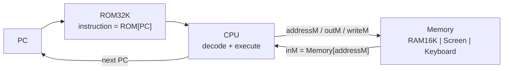
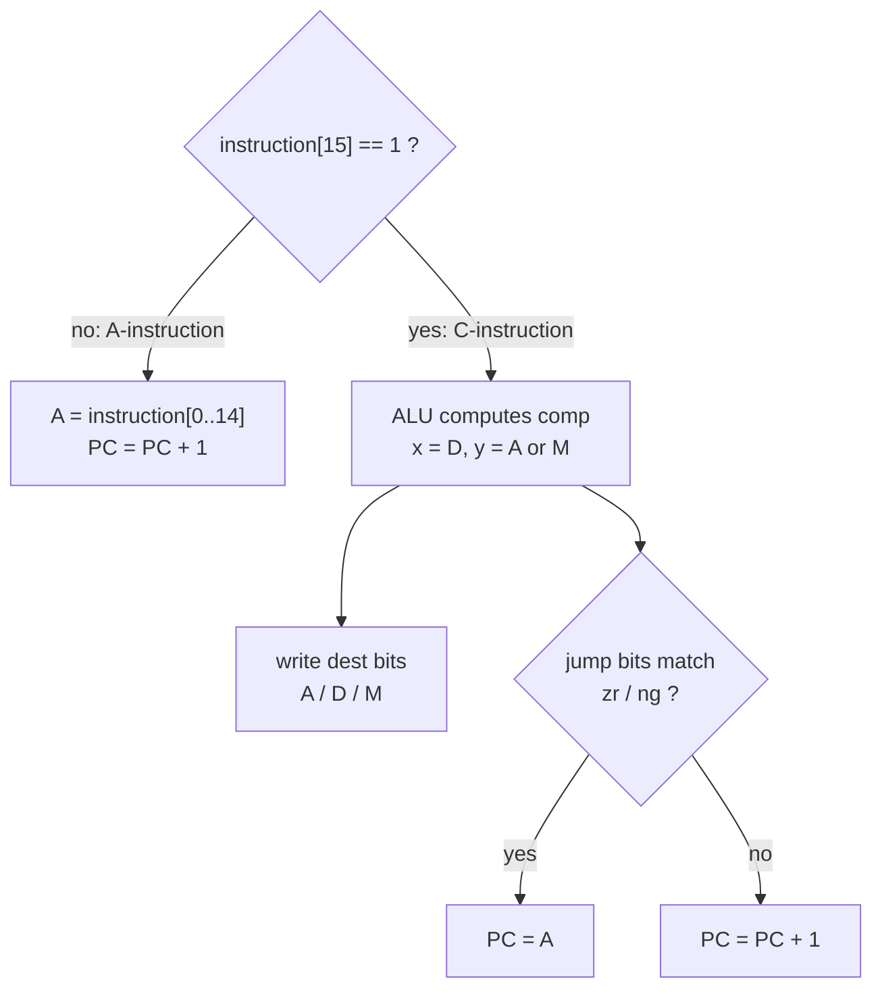
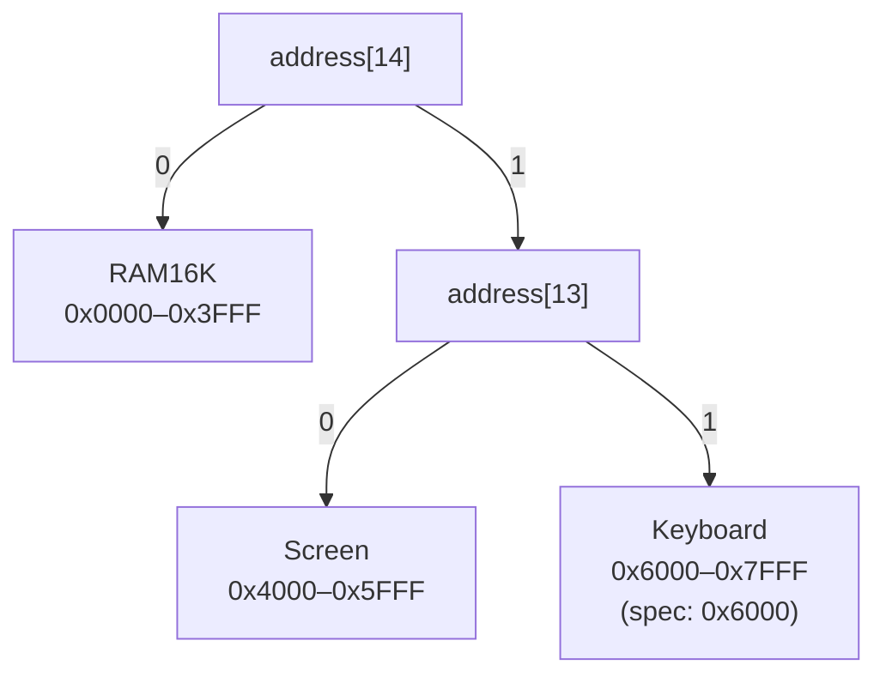

# Project 05 · Computer Architecture

[← Back to Part I overview](../README.md)

> **Nand2Tetris Part I · Project 05** — Assemble the CPU, the memory map and the complete Hack computer.

## Introduction

Project 05 is the integration point of Part I. The ALU from Project 02, the registers and RAM from Project 03, and the instruction set from Project 04 come together as three chips:

- **CPU** — fetch, decode and execute one instruction per cycle.
- **Memory** — one 16-bit data address space combining RAM16K, the screen and the keyboard.
- **Computer** — ROM32K + CPU + Memory, the machine that actually runs Hack programs.

The result is a stored-program computer: instructions live in ROM32K and are fetched by the PC, while data lives in the separate Memory chip and is addressed by `addressM`.

## What's in this folder

| File | Chip | Role |
|---|---|---|
| `CPU.hdl` | CPU | Decodes A/C instructions, drives the ALU, updates A/D, writes memory, computes jumps and the next PC. |
| `Memory.hdl` | Memory | Address decoder for RAM16K (`0x0000–0x3FFF`), Screen (`0x4000–0x5FFF`) and Keyboard (`0x6000`). |
| `Computer.hdl` | Computer | Wires ROM32K, CPU and Memory into a complete machine driven by `reset`. |
| `project5.zip` | — | Coursera submission archive; not needed to build or run. |

## Key concepts

- **Stored-program execution.** The program is data in ROM; the CPU repeatedly fetches `ROM[PC]`, decodes it and executes it. Changing the ROM contents changes the machine's behavior without changing the hardware.
- **Fetch–decode–execute.** One instruction per clock cycle: fetch at the PC, decode bit fields, compute in the ALU, write destinations, then update the PC.
- **Instruction bits are control signals.** There is no separate microcode: `instruction[15]` selects A vs C, bits `[11..6]` drive the ALU, `[5..3]` select destinations, and `[2..0]` select the jump condition.
- **The A register has two jobs.** It is a general-purpose register for the ALU, and it is also the address pointer for data memory (`M = RAM[A]`). An A-instruction loads it with a constant; a C-instruction can load it with the ALU result.
- **Memory-mapped I/O.** The same `load`/`address` interface reaches RAM, screen and keyboard. Writing to `SCREEN` draws pixels; reading `KBD` returns the pressed key.
- **Clocked vs combinational outputs.** `outM` and `writeM` are produced combinationally during the current cycle; `addressM` and `pc` commit on the clock edge.
- **Reset.** `reset = 1` forces the PC to 0, restarting the program on the next cycle.

### Instruction fields seen by the CPU

| Bits | Meaning |
|---|---|
| `instruction[15]` | `0` = A-instruction, `1` = C-instruction |
| `instruction[12]` | ALU `a` bit: `y = M` when 1, `y = A` when 0 |
| `instruction[11..6]` | ALU control: `zx, nx, zy, ny, f, no` |
| `instruction[5]` | C-instruction destination A |
| `instruction[4]` | C-instruction destination D |
| `instruction[3]` | C-instruction destination M (`writeM`) |
| `instruction[2..0]` | Jump bits: negative, zero, positive |

## Flowchart

### The complete machine

### One CPU cycle

### Data memory map

## Implementation notes

- **CPU — A register:** `isA = NOT instruction[15]`. The A register loads on an A-instruction or on a C-instruction whose `dest` includes A (`instruction[5]`). Its input is the instruction word for A-instructions and the ALU output otherwise.
- **CPU — D register:** loads only on a C-instruction with `instruction[4]` set.
- **CPU — ALU:** `x = D`; `y` is `A` or `inM` selected by `instruction[12]`; control bits come directly from `instruction[11..6]`.
- **CPU — memory write:** `writeM = isC AND instruction[3]`; `outM` is the ALU output and `addressM` is the low 15 bits of A.
- **CPU — jump:** a jump is taken when the instruction is a C-instruction and the requested condition matches `zr`/`ng`: negative (`instruction[2]`), zero (`instruction[1]`), or positive (`instruction[0]`).
- **CPU — PC:** `load = jump`, `inc = NOT jump`, `reset = reset`, input = A. This gives jumps priority over sequential execution.
- **Memory:** `isRAM = NOT address[14]`, `isScreen = address[14] AND NOT address[13]`, `isKbd = address[14] AND address[13]`. The write-enable is gated by these signals; reads are selected with a Mux16 tree.
- **Computer:** `ROM32K(address=pc)` feeds `CPU(instruction=...)`; the CPU's `outM`, `writeM`, `addressM` feed `Memory`; the memory output returns as `inM`.

## How to verify

The official test scripts and the Hardware Simulator are not bundled in this repository. Download the Project 05 test files from [nand2tetris.org](https://www.nand2tetris.org/).

- `CPU.tst` and `Memory.tst` test the components with the simulator's clock.
- `Computer.tst` / `ComputerAdd.tst` / `ComputerMax.tst` / `ComputerRect.tst` load a `.hack` program into ROM32K and run the complete machine.
- Any program assembled by Project 06 can be loaded into the Computer's ROM for an end-to-end test.

`project5.zip` is the Coursera submission archive and is not required for simulation.
