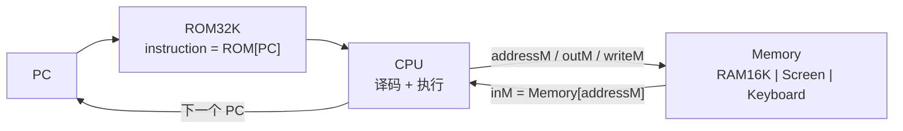
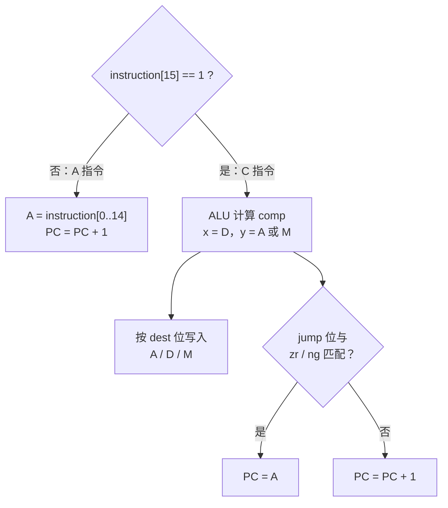
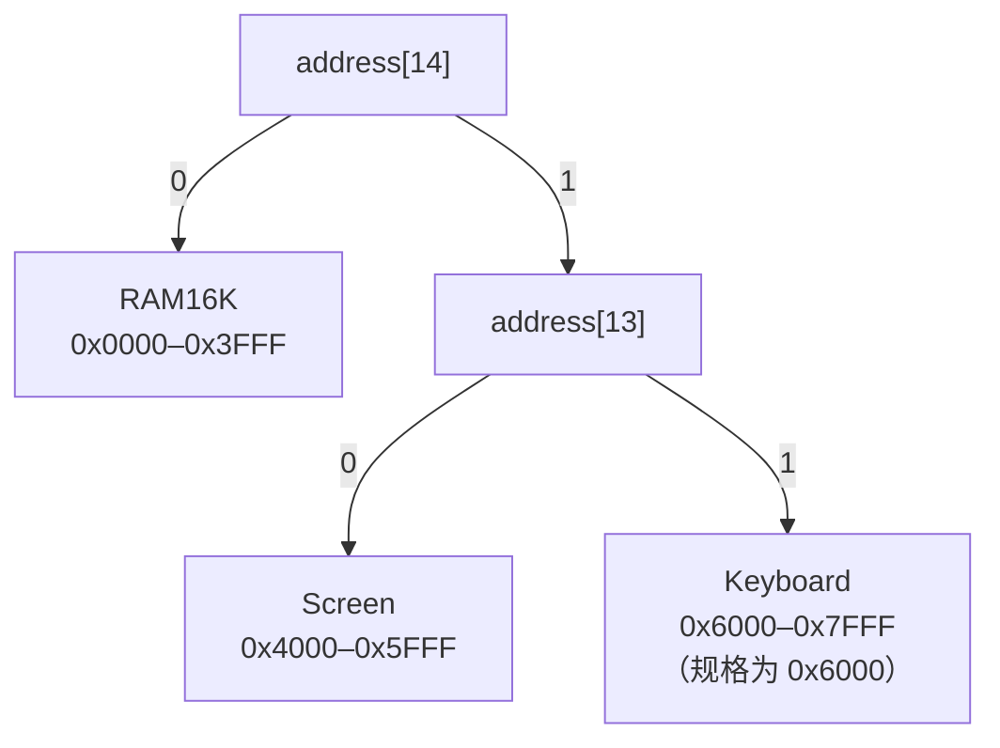

# 项目 05 · 计算机体系结构

[← 返回 Part I 总览](../README.md)

> **Nand2Tetris Part I · 项目 05** — 组装 CPU、内存映射和完整的 Hack 计算机。

## 项目简介

项目 05 是 Part I 的整合点。项目 02 的 ALU、项目 03 的寄存器与 RAM、项目 04 的指令集在这里汇合成三个芯片：

- **CPU** —— 每个周期完成取指、译码和执行。
- **Memory** —— 把 RAM16K、屏幕和键盘组合成一个 16 位数据地址空间。
- **Computer** —— ROM32K + CPU + Memory，真正能运行 Hack 程序的整机。

最终得到的是一台存储程序计算机：指令存放在 ROM32K 中，由 PC 取指；数据存放在独立的 Memory 芯片中，由 `addressM` 寻址。

## 目录内容

| 文件 | 芯片 | 作用 |
|---|---|---|
| `CPU.hdl` | CPU | 译码 A/C 指令，驱动 ALU，更新 A/D，写内存，计算跳转和下一个 PC。 |
| `Memory.hdl` | Memory | 为 RAM16K（`0x0000–0x3FFF`）、Screen（`0x4000–0x5FFF`）和 Keyboard（`0x6000`）做地址译码。 |
| `Computer.hdl` | Computer | 把 ROM32K、CPU 和 Memory 连接成由 `reset` 驱动的完整机器。 |
| `project5.zip` | — | Coursera 提交存档，运行和验证时不需要。 |

## 知识点

- **存储程序式执行**：程序本身就是 ROM 中的数据；CPU 反复取 `ROM[PC]`、译码并执行。只要改 ROM 的内容，就能改变机器行为，而不必改硬件。
- **取指—译码—执行**：每个时钟周期执行一条指令：在 PC 处取指，解析位字段，用 ALU 计算，写入目标，最后更新 PC。
- **指令位就是控制信号**：这里没有额外的微码：`instruction[15]` 选择 A/C 指令，`[11..6]` 驱动 ALU，`[5..3]` 选择目标寄存器，`[2..0]` 选择跳转条件。
- **A 寄存器的双重身份**：它既是 ALU 的通用寄存器，又是数据内存的地址指针（`M = RAM[A]`）。A 指令把它装成常数；C 指令可以把 ALU 结果写回它。
- **内存映射 I/O**：同一套 `load` / `address` 接口可以访问 RAM、屏幕和键盘。写 `SCREEN` 就是画像素；读 `KBD` 就是取当前按键。
- **时钟驱动与组合输出**：`outM` 和 `writeM` 在当前周期组合产生；`addressM` 和 `pc` 在时钟边沿才提交新值。
- **复位**：`reset = 1` 会把 PC 强制置 0，下一个周期从程序开头重新执行。

### CPU 看到的指令字段

| 位 | 含义 |
|---|---|
| `instruction[15]` | `0` = A 指令，`1` = C 指令 |
| `instruction[12]` | ALU 的 `a` 位：为 1 时 `y = M`，为 0 时 `y = A` |
| `instruction[11..6]` | ALU 控制位：`zx, nx, zy, ny, f, no` |
| `instruction[5]` | C 指令的目标 A |
| `instruction[4]` | C 指令的目标 D |
| `instruction[3]` | C 指令的目标 M（`writeM`） |
| `instruction[2..0]` | 跳转位：负数、零、正数 |

## 流程图

### 整机数据通路

### CPU 的一个周期

### 数据内存映射

## 实现要点

- **CPU — A 寄存器**：`isA = NOT instruction[15]`。A 在 A 指令或“dest 包含 A”的 C 指令（`instruction[5]`）时装载；A 指令装入指令字本身，C 指令装入 ALU 输出。
- **CPU — D 寄存器**：只在 `instruction[4]` 为 1 的 C 指令时装载。
- **CPU — ALU**：`x = D`；`y` 由 `instruction[12]` 在 `A` 和 `inM` 之间选择；控制位直接来自 `instruction[11..6]`。
- **CPU — 写内存**：`writeM = isC AND instruction[3]`；`outM` 是 ALU 输出，`addressM` 是 A 的低 15 位。
- **CPU — 跳转**：只有 C 指令才可能跳转，且请求的条件要与 `zr`/`ng` 匹配：负数（`instruction[2]`）、零（`instruction[1]`）或正数（`instruction[0]`）。
- **CPU — PC**：`load = jump`，`inc = NOT jump`，`reset = reset`，输入为 A。这样跳转优先于顺序执行。
- **Memory**：`isRAM = NOT address[14]`，`isScreen = address[14] AND NOT address[13]`，`isKbd = address[14] AND address[13]`。写使能由这些信号门控；读取用 Mux16 树选择。
- **Computer**：`ROM32K(address=pc)` 的输出接 `CPU(instruction=...)`；CPU 的 `outM`、`writeM`、`addressM` 接 `Memory`；内存输出回到 `inM`。

## 验证方式

官方的测试脚本和 Hardware Simulator 不在本仓库中。请从 [nand2tetris.org](https://www.nand2tetris.org/) 下载 Project 05 的测试文件。

- `CPU.tst` 和 `Memory.tst` 配合模拟器时钟测试各部件。
- `Computer.tst` / `ComputerAdd.tst` / `ComputerMax.tst` / `ComputerRect.tst` 会把 `.hack` 程序装入 ROM32K，运行整机。
- 项目 06 汇编器生成的任何 `.hack` 都可以装进 Computer 的 ROM，做端到端验证。

`project5.zip` 是 Coursera 的提交存档，仿真时不需要。
