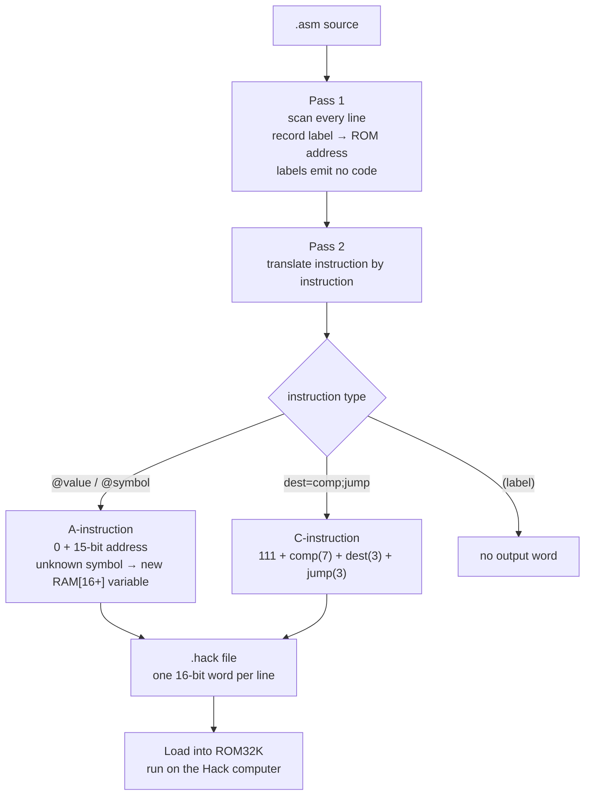
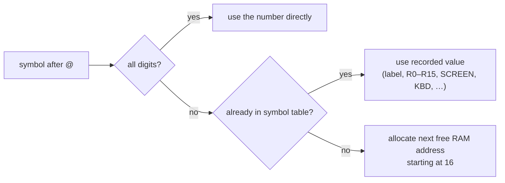

# Project 06 · The Assembler

[](README.md)
[](README.zh-CN.md)

[← Back to Part I overview](../README.md)

> **Nand2Tetris Part I · Project 06** — Implement the tool that translates Hack assembly into 16-bit machine code.

## Introduction

Project 06 is the software capstone of Part I. The Hack computer can only execute 16-bit binary words, but humans write assembly. This project closes the gap with a **two-pass assembler** written in Java.

The assembler reads a `.asm` file, strips comments and whitespace, resolves labels and variables through a symbol table, encodes every instruction, and writes a `.hack` file with one 16-bit word per line. That file can be loaded directly into the ROM32K of the Computer built in Project 05.

The implementation is split into three classes:

- **`Parser`** — turns source text into clean instructions and exposes their fields.
- **`Code`** — translates mnemonics (`comp`, `dest`, `jump`) into binary fields.
- **`Assembler`** — drives the two passes, owns the symbol table, and writes the output.

## What's in this folder

| File | Role |
|---|---|
| `Assembler.java` | Entry point. Accepts a `.asm` file or a directory; initializes predefined symbols; pass 1 records labels; pass 2 emits code and allocates variables; writes `<name>.hack`. |
| `Parser.java` | Reads the source line by line, removes whitespace and `//` comments, classifies A/C/L instructions, and extracts `symbol`, `dest`, `comp`, `jump`. Tracks source line numbers for errors. |
| `Code.java` | Static lookup tables: 28 `comp` encodings, 8 `jump` encodings, and `dest` encoded as an order-independent bitmask. Rejects invalid mnemonics. |
| `Assembler.class`, `Parser.class`, `Parser$InstructionType.class`, `Code.class` | Compiled bytecode; can be regenerated with `javac`. |
| `Add.asm` | Computes `R0 = 2 + 3`. |
| `Max.asm` | Computes `R2 = max(R0, R1)`. |
| `Rect.asm` | Draws a 16-pixel-wide rectangle at the top-left of the screen; `R0` controls its height. |
| `Pong.asm` | The complete Pong game — a large, realistic end-to-end test input. |
| `prog.txt` | Empty scratch file; not used by the assembler. |
| `project6.zip` | Coursera submission archive; not needed to build or run. |

## Key concepts

- **Two passes are necessary.** A label can be used before it is defined, so the assembler cannot emit code while it is still discovering label addresses. Pass 1 walks the whole file and records every `(label)` with the ROM address of the next real instruction. Pass 2 translates instructions with the completed symbol table.
- **Labels consume no ROM.** `(LOOP)` is a marker, not an instruction; only A- and C-instructions increment the ROM address counter.
- **The symbol table has three layers.** Predefined symbols (`R0–R15`, `SP/LCL/ARG/THIS/THAT`, `SCREEN`, `KBD`), user-defined labels, and variables. Variables are allocated on first use, starting at `RAM[16]` and moving upward.
- **A-instruction encoding.** `0` followed by a 15-bit address or constant. Numeric `@n` uses the number directly; a symbol is looked up, or allocated if unknown.
- **C-instruction encoding.** `111` + `a` (1 bit) + `comp` (6 bits) + `dest` (3 bits) + `jump` (3 bits). The `a` bit is part of the 7-bit `comp` field: `0` means the A register, `1` means `M = RAM[A]`.
- **Strict field validation.** `comp` and `jump` must match the lookup tables exactly; `dest` registers may appear in any order (`MD` and `DM` are both valid) but may not repeat.
- **The assembler is the hardware/software boundary.** Its output is exactly what Project 05's ROM32K expects, so assembling a program is the last step before running it on the machine built from NAND gates.

## Flowchart

### Two-pass translation



### Symbol resolution in pass 2



## Implementation notes

- **Comment/whitespace handling:** `Parser` removes all whitespace first, then cuts everything from `//`. Blank and comment-only lines are skipped by `advance()`; `lineNumber()` still refers to the physical source line, so errors point to the right place.
- **Instruction classification:** a line starting with `@` is an A-instruction, with `(` is an L-instruction (label), and anything else is treated as a C-instruction.
- **Field parsing:** `dest` is the text before `=` (or `null`); `jump` is the text after `;` (or `null`); `comp` is what remains between them.
- **Pass 1 duplicate check:** defining a label that already exists — including a predefined symbol — is rejected with a file and line number.
- **Variable allocation:** the counter starts at 16; each previously unseen non-numeric symbol in an A-instruction gets the next address.
- **Encoding helpers:** `convertToBinary` range-checks the address (`0–32767`) and pads to 16 bits; `Code.dest` builds a 3-bit mask (A = 100, D = 010, M = 001), so register order does not matter.
- **Directory mode:** `java Assembler <dir>` assembles every `.asm` file in that directory; `java Assembler <file>` handles one file.
- **Output naming:** the input name's extension is replaced with `.hack` in the same directory.

## How to run

Requires a JDK (tested with OpenJDK 21):

```bash
cd 06
javac Assembler.java Parser.java Code.java
java Assembler Add.asm
```

This produces `Add.hack` next to `Add.asm`:

```text
0000000000000010
1110110000010000
0000000000000011
1110000010010000
0000000000000000
1110001100001000
```

To assemble every test program at once:

```bash
java Assembler .
```

The resulting `.hack` files can be loaded into the CPU Emulator or into the ROM32K of the Project 05 Computer.
