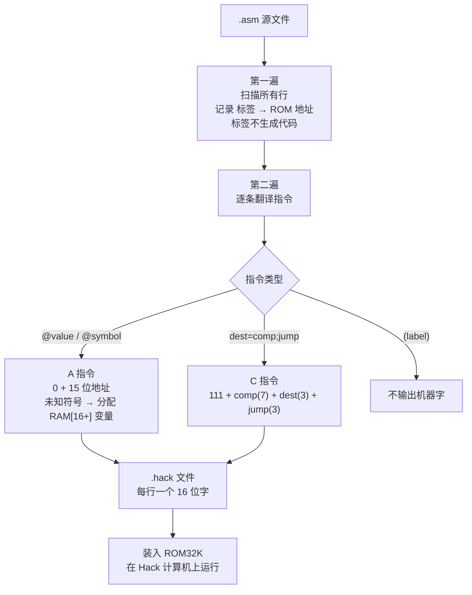
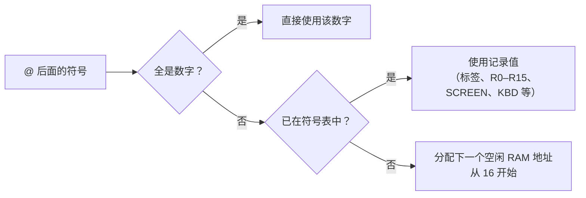

# 项目 06 · 汇编器

[](README.md)
[](README.zh-CN.md)

[← 返回 Part I 总览](../README.md)

> **Nand2Tetris Part I · 项目 06** — 实现把 Hack 汇编翻译成 16 位机器码的工具。

## 项目简介

项目 06 是 Part I 的软件收官。Hack 计算机只能执行 16 位二进制字，而人类编写的是汇编。这个项目用 Java 实现一个**两遍扫描的汇编器**，把两者连接起来。

汇编器读取 `.asm` 文件，去掉注释和空白，通过符号表解析标签与变量，编码每一条指令，最后写出 `.hack` 文件 —— 每行一个 16 位字。这个文件可以直接装入项目 05 构建的 Computer 的 ROM32K 中运行。

实现分为三个类：

- **`Parser`** —— 把源文本变成干净的指令，并暴露各字段。
- **`Code`** —— 把助记符（`comp`、`dest`、`jump`）翻译成二进制字段。
- **`Assembler`** —— 驱动两遍扫描，维护符号表，写出结果。

## 目录内容

| 文件 | 作用 |
|---|---|
| `Assembler.java` | 入口。接受 `.asm` 文件或目录；初始化预定义符号；第一遍记录标签；第二遍生成代码并分配变量；写出 `<name>.hack`。 |
| `Parser.java` | 逐行读入源文件，删除空白和 `//` 注释，区分 A/C/L 指令，提取 `symbol`、`dest`、`comp`、`jump`，并记录源文件行号用于报错。 |
| `Code.java` | 静态查找表：28 个 `comp` 编码、8 个 `jump` 编码，以及用位掩码实现的、与寄存器顺序无关的 `dest` 编码。非法助记符会报错。 |
| `Assembler.class`、`Parser.class`、`Parser$InstructionType.class`、`Code.class` | 已编译的字节码，可用 `javac` 重新生成。 |
| `Add.asm` | 计算 `R0 = 2 + 3`。 |
| `Max.asm` | 计算 `R2 = max(R0, R1)`。 |
| `Rect.asm` | 在屏幕左上角画一个 16 像素宽的矩形，高度由 `R0` 决定。 |
| `Pong.asm` | 完整的 Pong 游戏 —— 一个大型、真实的端到端测试输入。 |
| `prog.txt` | 空的临时文件，汇编器不使用。 |
| `project6.zip` | Coursera 提交存档，编译和运行时不需要。 |

## 知识点

- **为什么必须扫两遍**：标签可以在定义之前被使用，因此汇编器在还没发现所有标签地址时无法直接生成代码。第一遍走完整个文件，把每个 `(label)` 与下一条真实指令的 ROM 地址记录下来；第二遍再用完整的符号表翻译指令。
- **标签不占 ROM**：`(LOOP)` 只是标记，不是指令；只有 A 指令和 C 指令会让 ROM 地址计数器加一。
- **符号表的三层内容**：预定义符号（`R0–R15`、`SP/LCL/ARG/THIS/THAT`、`SCREEN`、`KBD`）、用户标签、变量。变量在首次使用时分配，从 `RAM[16]` 开始向上增长。
- **A 指令编码**：`0` 后接 15 位地址或常数。`@n` 中的数字直接使用；符号则查表，查不到就分配新地址。
- **C 指令编码**：`111` + `a`（1 位）+ `comp`（6 位）+ `dest`（3 位）+ `jump`（3 位）。`a` 位属于 7 位的 `comp` 字段：`0` 表示 A 寄存器，`1` 表示 `M = RAM[A]`。
- **严格的字段校验**：`comp` 和 `jump` 必须与查找表完全一致；`dest` 中的寄存器可以任意顺序出现（`MD` 和 `DM` 都合法），但不能重复。
- **汇编器是软硬件的分界线**：它的输出正是项目 05 的 ROM32K 所需要的格式，因此“汇编一个程序”就是在 NAND 搭出的机器上运行它的最后一步。

## 流程图

### 两遍扫描



### 第二遍的符号解析



## 实现要点

- **注释与空白处理**：`Parser` 先删除所有空白，再截断 `//` 之后的内容。空行和纯注释行由 `advance()` 跳过；`lineNumber()` 仍然对应源文件中的物理行，因此报错位置准确。
- **指令分类**：以 `@` 开头的行是 A 指令，以 `(` 开头的是 L 指令（标签），其余一律当作 C 指令。
- **字段解析**：`dest` 是 `=` 之前的文本（没有则为 `null`）；`jump` 是 `;` 之后的文本（没有则为 `null`）；`comp` 是两者之间的部分。
- **第一遍查重**：如果标签与已有符号（包括预定义符号）重名，会带文件名和行号报错。
- **变量分配**：计数器从 16 开始；A 指令中每个此前未见过的非数字符号都会拿到下一个地址。
- **编码辅助**：`convertToBinary` 检查地址范围（`0–32767`）并补足 16 位；`Code.dest` 构造 3 位掩码（A = 100，D = 010，M = 001），因此寄存器顺序无关紧要。
- **目录模式**：`java Assembler <dir>` 会汇编目录下所有 `.asm`；`java Assembler <file>` 只处理一个文件。
- **输出命名**：把输入文件名中的扩展名替换为 `.hack`，输出到同一目录。

## 运行方式

需要 JDK（已用 OpenJDK 21 验证）：

```bash
cd 06
javac Assembler.java Parser.java Code.java
java Assembler Add.asm
```

这会在 `Add.asm` 旁生成 `Add.hack`：

```text
0000000000000010
1110110000010000
0000000000000011
1110000010010000
0000000000000000
1110001100001000
```

如果要一次汇编目录下的所有测试程序：

```bash
java Assembler .
```

生成的 `.hack` 可以载入 CPU Emulator，或装入项目 05 Computer 的 ROM32K。
