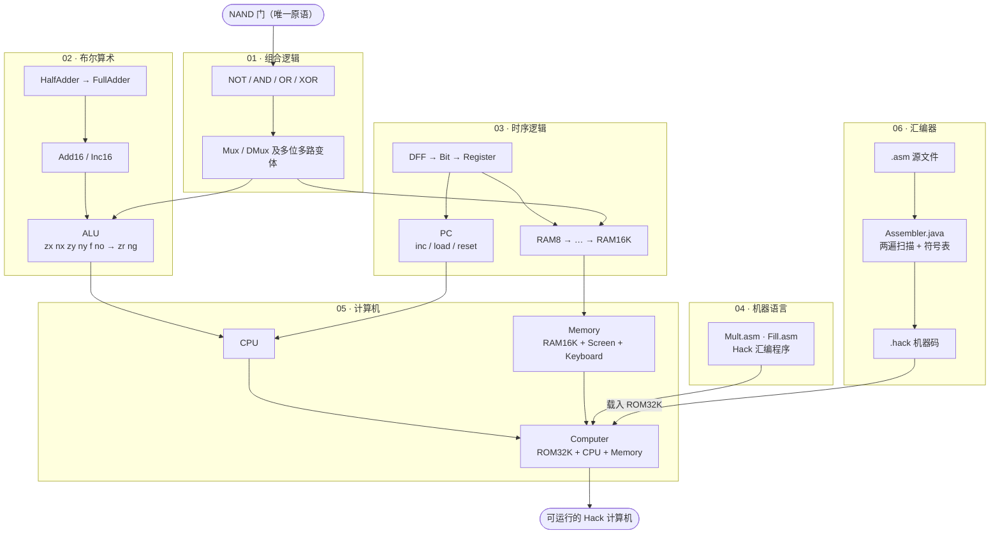
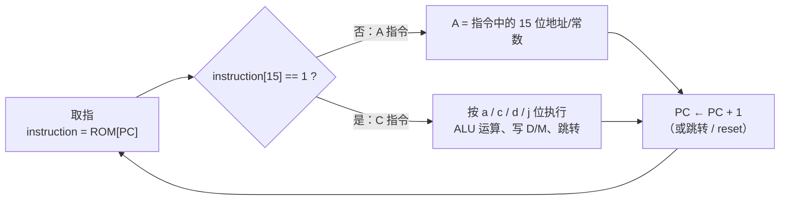

# NAND2TETRIS PART1

本目录收录 **Nand2Tetris 课程 Part I（Projects 01–06）** 的完整实现。
主线是：**只以 NAND 门为唯一原语，逐层构建出一台能运行程序的 Hack 计算机，编写机器语言程序，并实现把汇编翻译成机器码的汇编器。**

## 总览

| 项目 | 主题 | 主要内容 | 语言 |
|---|---|---|---|
| [01](01/) | 组合逻辑 | 用 NAND 构造基本门、多路选择器及其多位/多路变体 | HDL |
| [02](02/) | 布尔算术 | 半加器、全加器、16 位加法器、增量器、ALU | HDL |
| [03](03/) | 时序逻辑 | 触发器构成的位/寄存器、各级 RAM、程序计数器 | HDL |
| [04](04/) | 机器语言 | 用 Hack 汇编写乘法与屏幕填充程序 | Hack 汇编 |
| [05](05/) | 计算机体系结构 | CPU、内存映射、ROM+CPU+Memory 整机 | HDL |
| [06](06/) | 工具链 | 两遍扫描的汇编器，把 `.asm` 翻译为 `.hack` | Java |

```
NAND2TETRIS PART1/
├── README.md
├── 01/   组合逻辑门（15 个 .hdl）
├── 02/   布尔算术（5 个 .hdl）
├── 03/   时序逻辑（8 个 .hdl）
├── 04/   Hack 汇编程序（Mult.asm、Fill.asm）
├── 05/   整机（CPU.hdl、Memory.hdl、Computer.hdl）
└── 06/   汇编器（Assembler.java、Parser.java、Code.java）
```

> 每个项目目录下都有两份 README：`README.md`（英文，默认）和 `README.zh-CN.md`（中文）。页面顶部的语言按钮可互相切换。

---

## 各项目：做了什么 · 知识点

### 01 — 组合逻辑门

**做了什么：** 仅用 NAND 门实现 NOT、AND、OR、XOR，Mux / DMux，以及 16 位版本（Not16、And16、Or16、Mux16）和多路版本（Or8Way、Mux4Way16、Mux8Way16、DMux4Way、DMux8Way）。

**知识点：**

- **NAND 的通用性**：任何布尔函数都可以只用 NAND 表达，这是整门课“从一粒沙造计算机”的起点。
- 真值表 → 布尔表达式 → 电路的推导方法（积之和、德摩根定律）。
- **Mux 是硬件版的 `if`，DMux 是地址译码器**——后续 RAM 的读写选择全靠它们。
- 多位总线（16-bit bus）、按位并行操作、多路复用树的结构。
- HDL 的声明式写法：实例化子芯片、内部连线、按位/按段取信号（如 `out[0..7]`）。

### 02 — 布尔算术

**做了什么：** HalfAdder → FullAdder → Add16（行波进位加法器），Inc16，以及完整的 **ALU**（支持 18 种运算，输出 `zr`、`ng` 两个标志位）。

**知识点：**

- 二进制加法与进位链：全加器如何把进位逐位传递。
- **补码（two's complement）**：负数表示、减法即加补码、溢出直觉。
- **ALU 的控制位流水线**：`zx → nx → zy → ny → f → no` 依次变换输入，`zr`/`ng` 由输出推导。
- “控制位就是指令字段”的设计思想——为项目 05 的 CPU 译码埋下伏笔。

### 03 — 时序逻辑与存储

**做了什么：** 以 DFF 为原语实现 Bit（带 load 的一位存储）、Register（16 位寄存器），逐级搭建 RAM8 / RAM64 / RAM512 / RAM4K / RAM16K，以及带 `inc` / `load` / `reset` 的 **PC 程序计数器**。

**知识点：**

- **组合逻辑 vs 时序逻辑**：时钟、状态、时间步 `t` 与 `t-1` 的语义。
- DFF 加反馈回路如何产生“记忆”；`load` 使能端的作用。
- 用 **Mux/DMux 树做地址译码**，把寄存器堆扩展成大容量 RAM（层次化构建）。
- PC 三种操作的优先级逻辑：`reset` > `load`（跳转）> `inc`（顺序执行）。

### 04 — 机器语言

**做了什么：** 用 Hack 汇编实现两个程序：

- [Mult.asm](04/Mult.asm)：通过循环重复加法计算 `R2 = R0 * R1`；
- [Fill.asm](04/Fill.asm)：轮询键盘，按键时把整屏涂黑，松开时清屏。

**知识点：**

- Hack 指令集：**A 指令**（装入常数/地址）与 **C 指令**（计算 + 赋值 + 跳转三合一）。
- `A` / `D` / `M` 三个可操作对象，`@` 与“A 寄存器作指针”的寻址方式。
- 标签 + 条件跳转（`JGT`/`JEQ`/…）实现分支与循环——没有 `for`、没有乘法，一切靠跳转和加法。
- **内存映射 I/O**：`SCREEN = 16384`、`KBD = 24576`，读写内存地址就等于读写屏幕和键盘。
- 底层编程思维：手工管理寄存器、循环计数器和内存地址。

### 05 — 计算机体系结构

**做了什么：** 实现 [CPU.hdl](05/CPU.hdl)（取指—译码—执行）、[Memory.hdl](05/Memory.hdl)（统一地址空间）和 [Computer.hdl](05/Computer.hdl)（ROM32K + CPU + Memory 组装成整机）。

**知识点：**

- **存储程序结构**：程序作为二进制数据存放在 ROM32K 中，由 PC 取指；数据存放在独立的 Memory 中，由 `addressM` 访问。Hack 的指令与数据使用分离的地址空间，但都由同一颗 CPU 依次取指、译码、执行。
- 指令位直接作为控制信号：`instruction[15]` 区分 A/C 指令，`a`/`c`/`d`/`j` 位分别控制 ALU、目的寄存器、跳转。
- **A 寄存器的双重角色**：既是通用数据寄存器，又作为数据内存的地址指针。
- 内存映射：`0x0000–0x3FFF` RAM16K，`0x4000–0x5FFF` Screen，`0x6000` Keyboard。
- 取指—执行周期、`reset` 复位，以及各部件如何在时钟驱动下协同工作。

### 06 — 汇编器

**做了什么：** 用 Java 实现汇编器：`Parser` 负责逐行解析，`Code` 负责助记符到二进制字段的编码，`Assembler` 用**两遍扫描**和符号表完成翻译。仓库内含 Add、Max、Rect、Pong 等测试程序。

**知识点：**

- **两遍扫描（two-pass）**：第一遍记录标签对应的 ROM 地址；第二遍翻译指令并处理未定义符号（变量）。
- **符号表**：预定义符号（`R0–R15`、`SP/LCL/ARG/THIS/THAT`、`SCREEN/KBD`）、用户标签、从 `RAM[16]` 开始分配的变量。
- 指令编码：A 指令 = `0` + 15 位地址；C 指令 = `111` + `a` + `c1..c6` + `d1..d3` + `j1..j3`。
- 文本处理：去注释/空白、解析 `dest=comp;jump` 各字段、查表生成机器码。
- 汇编器是软硬件的分界：输出的 `.hack`（每行 16 个 0/1）可直接载入项目 05 的 ROM 执行。

---

## 流程图

### 构建流程图：从 NAND 到整机



### 程序执行流程图：CPU 的一个周期



---

## 验证方式

课程官方的测试脚本、硬件模拟器、CPU 模拟器不包含在本目录中，可从 [nand2tetris.org](https://www.nand2tetris.org/) 获取：

- **01 / 02 / 03 / 05**：用 Hardware Simulator 打开对应的 `.hdl` 文件，加载官方 `.tst` 测试脚本运行。
- **04**：用 CPU Emulator 载入 `Mult.asm` / `Fill.asm` 执行（`Fill` 需在模拟器中观察屏幕与键盘）。
- **06**：需要 JDK：

  ```bash
  cd 06
  javac Assembler.java Parser.java Code.java
  java Assembler Pong.asm   # 生成 Pong.hack
  ```

  生成的 `.hack` 文件可载入 CPU Emulator 验证。

> 注：各项目中的 `projectN.zip` 为提交到 Coursera 评分器的存档，不是运行所必需的文件。

---

## 来源与许可

- 课程：[Nand2Tetris](https://www.nand2tetris.org/) — Noam Nisan & Shimon Schocken。
- 仓库结构与部分课程骨架代码参考 [pzuehlke/NAND2Tetris](https://github.com/pzuehlke/NAND2Tetris)（GPL-3.0）。
- 本仓库中的双语项目 README 为本仓库新增内容；许可证见 [LICENSE](LICENSE)。
